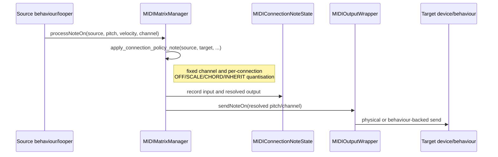
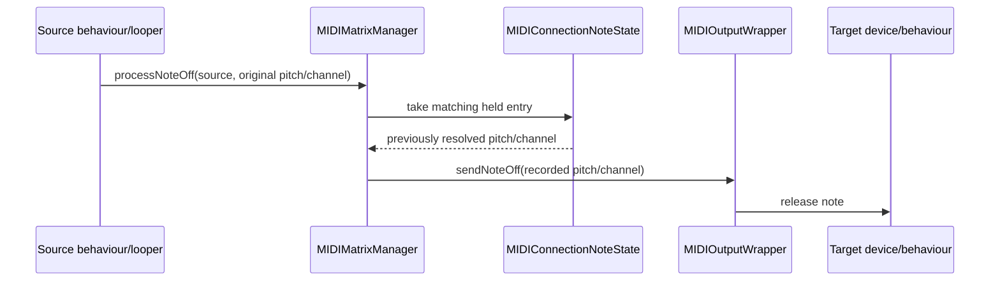
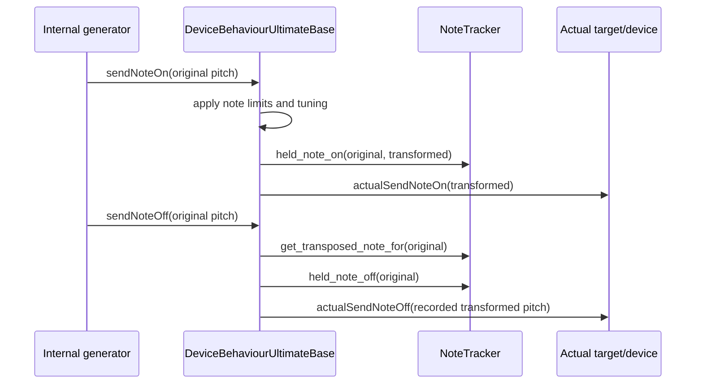

# MIDI note routing and quantisation

This document describes note ownership after quantisation became a per-connection policy.

## Connections and pause

The matrix stores up to 128 configured source-target connections in
`MIDIConnectionStore`, with a sorted linked list per source. MIDI events visit
only that source's configured connections, in ascending target order as before.
Disallowed feedback pairs are kept separately and survive a routing reset.
If connection capacity is exhausted, existing connections remain unchanged;
the matrix popup reports the failure and the serial log identifies the pair.

In the matrix's target selection, press **[>]** to open the connection popup.
**Paused: yes/no** suspends or resumes an existing connection. A paused route
remains connected for counts, display, and project saving, but carries no Note
On, Note Off, CC, or pitch-bend events. Pausing immediately releases its recorded
notes, including dropped-note ledger entries. Other sources holding the same
target pitch retain the existing wrapper refcount protection.

Resume does not replay previously held keys: a new Note On is required.
Connection policy changes while paused do not start notes. Channel, quantise,
and pause controls are disabled until a connection exists; disconnected pairs
no longer have policy storage. Disconnecting removes the policy; reconnecting
creates the usual defaults, including quantisation off for drum endpoints.

Each endpoint and connection records its latest event timestamp and whether it
has received an event. Paused routes do not update connection/target activity,
but input activity is still recorded on their source. Held-note counts are
queried from the existing ledger rather than maintained in a second counter.

Project routing is saved as:

```text
midi_matrix~<source>~<target>~connection=version=2;channel=0;quantise=0;note_map=0;paused=1
```

Version 1 connection lines load as unpaused; legacy `targets=a;b;...` lines still
load using normal connection defaults. Malformed known policy fields or
unsupported versions are logged and skipped without replacing an existing
connection. Unknown fields are ignored for extension. Older firmware does not
understand pause, so it cannot preserve paused state when loading these files.

### Where quantisation happens

Note quantisation is a property of the **connection**, not the source. Each
route chooses `inherit` (global mode), `off`, `scale`, or `chord`. Behaviours
emit unquantised pitches; `sendNoteOn` applies only target-local note limits
and tuning, never the global quantiser.

Exceptions are sources whose pitch selection is intrinsically harmonic:

- **Progression** generates chord tones from the arranger's current chord. It
  returns `true` from `regenerates_notes_on_harmony_change()` and implements
  `on_harmony_changed()` to stop and replay its chord. The matrix skips
  migrating held notes from such sources so they are not moved twice. Its
  routes still apply their policy as normal (usually a no-op).
- **seqlib FlexiArp / chord generator outputs** pick scale degrees themselves
  and keep their own Scale/Chord quantise control.
- **seqlib trigger-count output** (Euclidian bass) keeps its Scale/Key setting
  because it uses the scale root as its base note; its result is otherwise
  chromatic unless the route quantises.

The build defines `SEQLIB_EXTERNAL_NOTE_QUANTISE`, which bypasses and hides the
per-output **Quant** control on other seqlib `MIDINoteOutput`s (for example
TuringMachine). Other projects using seqlib without the matrix keep that
control. Saved legacy Quant settings still load but are ignored.

On harmony change the `Conductor` notifies the matrix, which migrates held
routed notes per connection (skipping regenerating sources) and then calls
`on_harmony_changed()` on every behaviour, when either the previous or new
global mode is not `NONE`.

## Stuck-note diagnostics

The serial console provides a bounded note recorder and a live held-note snapshot:

| Command | Purpose |
|---|---|
| `notes list` | List source/target IDs, handles, roles, and owner labels. |
| `notes status` | Show ledger occupancy, recorder state, filters, overwritten events, and byte costs. |
| `notes held [source_id] [target_id]` | Show held route notes, their ages, policies, and target-wide wrapper counters. Use `-1` for either wildcard. |
| `notes owner <exact label>` | Show held notes and routes for all roles belonging to that owner. Labels may contain spaces; do not quote them. |
| `notes on [source_id] [target_id]` | Enable recording, optionally limited to one source/target pair. Omitted filters are wildcards. |
| `notes off` | Freeze history without clearing it or affecting notes. |
| `notes clear` | Clear history and its overwrite counter; retain recording state and filters. |
| `notes dump` | Freeze and print history in oldest-to-newest order, followed by a live held-note snapshot. |

### Capturing an intermittent stuck note

For a suspected interaction between sources (for example, Prog.Bass and a
TuringMachine output both feeding Neutron), capture **all sources to that target**,
not just one source.

1. Run `notes list` and save its output. Identify the target ID and the actual
   connected source handles/roles. IDs depend on the enabled devices; do not
   assume fixed numbers or a particular TuringMachine channel.
2. Before starting the capture, stop playback and use the usual panic/all-notes-off
   action to clear any already-stuck notes. Keep the failing routes and
   quantisation settings unchanged.
3. Run the following, substituting the numeric target ID:

   ```text
   notes clear
   notes on -1 <target-id>
   ```

   `-1` includes every source feeding that target. For example, if the Neutron
   target is currently ID 2, use `notes on -1 2`. To include source-only arrivals
   or investigate a project transition across multiple targets, use `notes on`
   without filters instead. A single-route capture, `notes on <source-id>
   <target-id>`, is useful only when other sources are not part of the symptom.
4. Start playback and reproduce the symptom. As soon as it occurs, run:

   ```text
   notes dump
   ```

   Capture **before stopping playback, panic, pause, disconnect, or another
   project load**. If stopping playback itself triggers the symptom, dump
   immediately afterwards and record that fact. Dump freezes recording, not
   playback, and does not silence notes.
5. Save the complete output, from the first `MIDI notes:` status line through
   the final target/pitch counter lines, along with `notes list`. Include the
   relevant saved project/routing settings and whether the symptom arose during
   playback, on stop, or after project load. Then stop/panic normally.

If the fault does not recur, keep this procedure for next time rather than
changing musical settings solely to force a diagnosis. `notes held` can inspect
current ledger state without previously enabling recording. `notes off` freezes
existing history; `notes clear` explicitly discards that history.

### Interpreting a capture

| Evidence | What to investigate |
|---|---|
| Held ledger entry with no corresponding release in retained history | The matrix still considers that input held. The release may not have arrived, or may be outside the recording window. |
| `UNMATCHED_OFF` at a different input pitch/channel from the held entry | Pairing is inconsistent at the matrix input; inspect the upstream generator/filter. This alone does not prove a quantiser bug. |
| `PAIRED_OFF`, then `SUPPRESSED_OFF` | The wrapper believes another note still holds that pitch. Compare the remaining target-wide refs against all held routes, including other sources. Suppression can be legitimate. |
| `PAIRED_OFF`, then `SEND_OFF` at the expected pitch/channel | The release reached the wrapper handoff boundary. Inspect target-local transformations, transport, and device behaviour; physical receipt is not established. |
| `LEDGER_FULL` or `REFCOUNT_LIMIT` | Tracking capacity was exceeded. Investigate this before assuming the note counts balance. |

For example, an input Note On at 60 mapped to output 62, followed by an input
Note Off at 62 that is unmatched while input 60 remains held, points to a
mismatch upstream of matrix pairing. An input Note Off at 60 releasing the
recorded output 62 instead demonstrates correct matrix pairing for that event.
Missing history limits either conclusion; preserve the reported overwrite count.

The recorder retains the latest 128 events, not 128 notes: a single note can
generate several events. Full history overwrites the oldest entries and reports
the number overwritten. Recording allocates its fixed buffer once on first use;
`off`, `clear`, and `dump` retain that allocation and do not touch musical state.
`notes status` reports actual object byte sizes for this build, including ledger
storage. Start timestamps are always retained in held ledger entries, even with
recording off; age uses wrap-safe unsigned millisecond subtraction (up to one
millisecond-counter wrap). There is no age threshold or automatic note release.

Event records distinguish matrix source arrivals (`SOURCE_*`), transformed
connection pairing (`PAIRED_*`), missing pairs (`UNMATCHED_OFF`), paused arrivals,
ledger exhaustion, policy changes, old/new migration mappings, and cleanup.
`DISPATCH_*` records calls to the output wrapper; `SEND_*` records the wrapper's
handoff attempt to its transport/behaviour. `SUPPRESSED_OFF` includes the remaining
pitch refcount, and `REFCOUNT_LIMIT` identifies the existing counter saturation.
These diagnostics **do not change refcount, quantisation, or pairing semantics**.
Forced panic reports ledger discards and attempted channel-wide panic operations
rather than inserting hundreds of individual raw panic Note Offs.

Records include source/target attribution, boot-relative time, original start
time where paired, input/output pitch/channel, policy, and global quantise mode.
`refs=-1` means unknown or a path that bypasses wrapper counters. Source-only
events have no target and are excluded by a target filter; route-attributed
pairing events still retain the original input. Global routing-reset markers
are retained with any filter.

The held snapshot shows current connection mappings and current behaviour
tuning/effective note limits, not a recomputed physical output or full historical
transform configuration. Wrapper refcounts are target-wide, pitch-only, and
include other sources even in filtered snapshots. A live snapshot copies one
ledger entry at a time; it is not an atomic snapshot of the entire performance.
It does not run target resolution or voice allocation for inspection.

The bounded recorder update and per-entry snapshot copies use short
interrupt-state-preserving critical sections, since clock-driven sources may
emit from interrupts. No allocation, serial formatting, or transport sending
occurs inside those diagnostic critical sections. Recording itself never writes
to serial; explicit dumps can still perturb playback timing, so keep captures
short and consider an external MIDI monitor for delivery-level evidence.

`SEND_*` is **not proof of device receipt**, and a long-held ledger entry is not
necessarily stuck. These diagnostics start at the matrix boundary: they do not
yet trace inside seqlib's independent quantisation filter or behaviour-local
note trackers. The reported Turing Machine -> Neutron issue remains unexplained;
the BeatStep comparison and possible quantiser interaction are investigation
leads, not established causes.

## Two note paths

There are two distinct paths through `DeviceBehaviourUltimateBase`:

1. **Matrix-routed notes** originate at a registered matrix source and travel through a source-target connection. `MIDIMatrixManager` owns their dynamic quantisation and Note On/Off pairing.
2. **Behaviour-local notes** are sent directly by a behaviour, for example by an internal sequencer or chord generator. `DeviceBehaviourUltimateBase` owns their global quantisation and Note On/Off pairing.

These paths intentionally use different trackers. Removing either tracker would leave its path unable to release the pitch that was actually started after harmony changed.

## Matrix-routed Note On



Each occupied ledger entry represents one logical held Note On for one connection. It stores:

- source and target IDs;
- original input pitch/channel;
- resolved connection output pitch/channel;
- original velocity;
- whether the policy emitted or dropped the note.

A dropped note is still recorded because a harmony or policy change can make it valid while its key remains held.

## Matrix-routed Note Off



The connection policy is **not recalculated on ordinary Note Off**. Recalculating against current harmony was the source of stuck notes: the release could target a different pitch from the earlier Note On.

## Harmony or connection-policy change

`MIDIMatrixManager::migrate_connection_notes()` recalculates each affected held entry from its original input:

1. Compare the current recorded output with the output under the new harmony/policy.
2. Stop every changed old output.
3. Start every changed new valid output using the original velocity.
4. Update the ledger entry.

Stopping all changed notes before starting replacements keeps `MIDIOutputWrapper` pitch refcounts correct when several inputs collapse onto the same quantised pitch.

## Behaviour-backed targets

`MIDIOutputWrapper_Behaviour` calls `sendRoutedNoteOn()` and `sendRoutedNoteOff()` rather than ordinary behaviour sends.

The scoped routed-note dispatch depth exists so virtual behaviour logic still runs (for example polyphonic voice selection or arpeggiator trigger channels), while the base behaviour knows that connection quantisation and pairing have already been handled by the matrix. It is call-stack state, not held-note state: an RAII guard increments it before each synchronous routed delivery and restores it when that call returns. It does not wait for Note Off. In that context the base class:

- does not apply global harmony quantisation again;
- does not add the note to the behaviour-local `NoteTracker`;
- still applies target-local note limits and `TUNING_OFFSET`;
- sends through `actualSendNoteOn()` / `actualSendNoteOff()`.

The scope is restored after each routed call so later direct behaviour sends use the local path normally. Nested routed calls increase the depth and unwind correctly.

### Target-local transform changes

The matrix ledger records the value sent to the target wrapper. It does not observe the final pitch produced inside a behaviour target, including target note limits, `TUNING_OFFSET`, polyphonic voice allocation, and CV per-channel limits. Routed Note Off normally recomputes those target-local transforms symmetrically.

Behaviour note-limit setters and modulated effective-limit parameters explicitly migrate held notes. Before changing a limit, the manager snapshots each held route's resolved target pitch and channel without emitting anything. Afterwards it compares the new result and only releases or starts outputs whose resolved result changed. Notes valid at the same pitch and channel before and after are untouched. `TRANSPOSE` moves notes whose output changes into range, while `IGNORE` stops notes that are now out of range. The ledger entries remain occupied so the eventual source Note Off is still paired and consumed.

Connection-policy migration and target-transform migration use the same two-pass migration engine: all changed old outputs are released before any replacement outputs start. Connection-policy migration resolves from the original input and commits new connection pitch/channel values to the ledger. Target-transform migration compares a pre-change snapshot with the behaviour's current resolved output, emits directly at that target boundary, and leaves the connection-level ledger mapping unchanged.

Direct behaviour notes use the same comparison rule through the behaviour `NoteTracker`: unchanged mappings remain sounding, changed valid mappings are moved, and newly invalid mappings are stopped. Other mutable target-local transforms must use the same begin/end notification or provide their own migration.

Target-transform migration emits through `send_resolved_routed_note_on/off`, bypassing the behaviour's `sendNoteOn/Off` overrides. Behaviours with their own note state must account for this: `MIDIBassBehaviour` reports routed notes as not emitted while droning (the drone owns the single sounding note) and keeps its held/machinegun note in step with migrated notes otherwise.

## Behaviour-local notes

### Drone bar lifecycle

Bar dispatch first calls `on_bar_prepare()` on every behaviour, then calls
`on_bar()` on every behaviour. Drone receivers release any leftover drone and
arm first-note capture in the preparation pass. This must finish before
Progression's bar callback can emit Prog.Bass, regardless of registration order.
Resetting in the receiver's ordinary bar callback would forget or immediately
stop that newly received note and leave machinegun without a pitch to retrigger.

The drone owns its sustained note independently of the source's Note Off.
Drone playback bypasses the local NoteTracker, and drone release clears both
the Drone note and the matching Current display state. Ignored incoming notes
do not change the captured drone channel.



The behaviour `NoteTracker` remains necessary for this direct path. It does not quantise: when note limits change, `DeviceBehaviourUltimateBase::reapply_local_note_limits()` re-evaluates locally held notes against the new limits (drum behaviours excluded). Harmony changes reach behaviours only through `on_harmony_changed()`, which generators such as Progression override to regenerate their musical state.

## Ownership summary

| Concern | Owner |
|---|---|
| Per-connection quantise mode, fixed channel, and pause | `MIDIMatrixManager::connections` (`MIDIConnectionStore`) |
| Routed input to resolved connection pitch/channel | `MIDIConnectionNoteState` |
| Routed output pitch refcounts shared by sources | `MIDIOutputWrapper::playing_notes` |
| Direct behaviour input to limited/tuned pitch | `DeviceBehaviourUltimateBase::note_tracker` |
| Target-local limits, tuning, voice allocation | Target behaviour/output implementation |
| Harmony-change notification | `Conductor` |
| Routed harmony migration | `MIDIMatrixManager::migrate_connection_notes()` |
| Generator harmony regeneration | `DeviceBehaviourUltimateBase::on_harmony_changed()` overrides (with `regenerates_notes_on_harmony_change()`) |
| Direct-note limit migration | `DeviceBehaviourUltimateBase::reapply_local_note_limits()` |

## Panic behavior

Normal route cleanup uses recorded ledger outputs. Forced panic deliberately ignores known state: the manager discards relevant ledger entries without emitting their individual releases, then performs one raw Note Off sweep across every MIDI pitch on each relevant channel. This preserves the purpose of `force` without duplicating tracked Note Off events.
